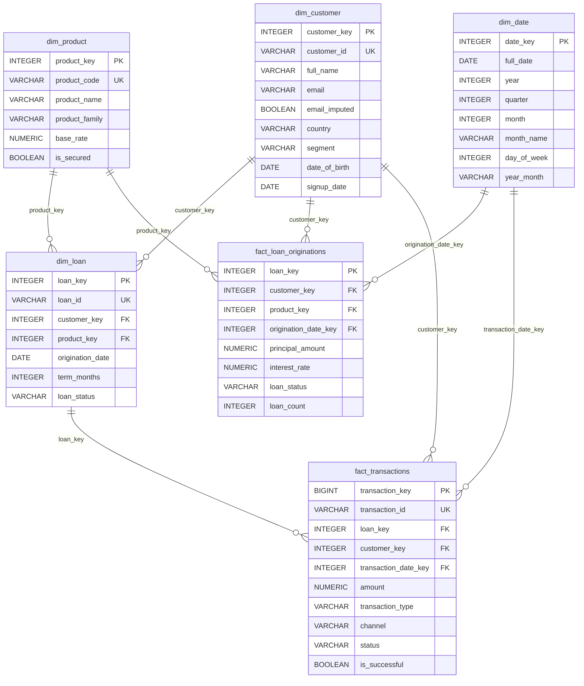

# Helix Finance Data Dictionary

Version: 1.0  
Database: PostgreSQL 16 (Docker Compose)  
Schema: `public`  
Warehouse style: Kimball star schema with two fact tables and four conformed dimensions  
Refresh pattern: full atomic refresh managed by `python -m finance_dwh.pipeline`

## 1. Source systems

| Source file | Simulated system | Grain | Raw columns |
|---|---|---|---|
| `data/raw/crm_customers.csv` | CRM / customer master | Customer update record | `customer_id`, `first_name`, `last_name`, `email`, `date_of_birth`, `country`, `customer_segment`, `created_at` |
| `data/raw/product_catalog.csv` | Product reference feed | Product | `product_code`, `product_name`, `product_family`, `base_rate`, `is_secured` |
| `data/raw/loan_core.csv` | Core lending platform | Loan contract | `loan_ref`, `borrower_id`, `product_code`, `principal`, `annual_rate`, `term_months`, `origination_dt`, `loan_status` |
| `data/raw/payment_ledger.csv` | Payments / servicing ledger | Transaction event | `txn_id`, `loan_ref`, `borrower_id`, `txn_date`, `amount`, `transaction_type`, `channel`, `status` |

The raw sources intentionally include duplicate updates, blank identifiers, orphan foreign keys, malformed dates, mixed date and number formats, inconsistent category casing, and missing optional values.

## 2. Entity relationship diagram



## 3. Dimensions

### 3.1 `dim_date`

Grain: one row per calendar day. Coverage is month-aligned from the earliest to the latest date observed across customer signup, loan origination, and transaction events.

| Column | PostgreSQL type | Nullable | Key / constraint | Description |
|---|---|---:|---|---|
| `date_key` | `INTEGER` | No | PK | Integer date key in `YYYYMMDD` form, e.g. `20261031`. |
| `full_date` | `DATE` | No | Unique | Calendar date. |
| `year` | `INTEGER` | No | | Calendar year. |
| `quarter` | `INTEGER` | No | | Calendar quarter, 1–4. |
| `month` | `INTEGER` | No | | Month number, 1–12. |
| `month_name` | `VARCHAR(20)` | No | | English month name. |
| `day_of_month` | `INTEGER` | No | | Day number, 1–31. |
| `day_of_week` | `INTEGER` | No | | ISO weekday, Monday = 1, Sunday = 7. |
| `day_name` | `VARCHAR(20)` | No | | English weekday name. |
| `is_weekend` | `BOOLEAN` | No | | `TRUE` for Saturday and Sunday. |
| `year_month` | `VARCHAR(7)` | No | Indexed | Reporting period in `YYYY-MM` form. |

### 3.2 `dim_customer`

Grain: one row per de-duplicated natural customer ID. When duplicate CRM updates exist, the record with the latest `created_at` wins.

| Column | PostgreSQL type | Nullable | Key / constraint | Description |
|---|---|---:|---|---|
| `customer_key` | `INTEGER` | No | PK | Surrogate key assigned after de-duplication. |
| `customer_id` | `VARCHAR(32)` | No | Unique | Normalized natural key, e.g. `CUST-0001`. Whitespace is removed and letters are uppercased. |
| `full_name` | `VARCHAR(160)` | No | | Concatenated first and last name after whitespace cleanup. |
| `email` | `VARCHAR(255)` | No | | Lowercased email. Invalid or missing emails are replaced with `unknown+<customer_id>@example.com`. |
| `email_imputed` | `BOOLEAN` | No | | `TRUE` when a placeholder email was substituted. |
| `country` | `VARCHAR(80)` | No | | Cleaned country; missing values become `Unknown`. |
| `segment` | `VARCHAR(40)` | No | | Canonical segment: `Retail`, `Premium`, `Private Banking`. Missing values default to `Retail`. |
| `date_of_birth` | `DATE` | Yes | | Parsed date of birth. Invalid or missing dates are stored as `NULL`. |
| `signup_date` | `DATE` | No | | Parsed CRM `created_at` date; required and used for duplicate selection. |

### 3.3 `dim_product`

Grain: one row per de-duplicated product code.

| Column | PostgreSQL type | Nullable | Key / constraint | Description |
|---|---|---:|---|---|
| `product_key` | `INTEGER` | No | PK | Surrogate key assigned after de-duplication. |
| `product_code` | `VARCHAR(32)` | No | Unique | Normalized product code, e.g. `PL_PERSONAL`. |
| `product_name` | `VARCHAR(120)` | No | | Product display name. |
| `product_family` | `VARCHAR(80)` | No | | Product family, e.g. `Mortgage`. |
| `base_rate` | `NUMERIC(6,3)` | No | | Catalog base annual rate, expressed as a percentage (e.g. `5.400`). |
| `is_secured` | `BOOLEAN` | No | | Whether the product is secured by collateral. |

### 3.4 `dim_loan`

Grain: one row per de-duplicated loan contract. When duplicate loan updates exist, the latest origination data wins.

| Column | PostgreSQL type | Nullable | Key / constraint | Description |
|---|---|---:|---|---|
| `loan_key` | `INTEGER` | No | PK | Surrogate key assigned after de-duplication. |
| `loan_id` | `VARCHAR(32)` | No | Unique | Normalized natural loan ID, e.g. `LN-000001`. |
| `customer_key` | `INTEGER` | No | FK → `dim_customer.customer_key` | Owning customer. |
| `product_key` | `INTEGER` | No | FK → `dim_product.product_key` | Loan product. |
| `origination_date` | `DATE` | No | | Parsed loan origination date. |
| `term_months` | `INTEGER` | No | | Contract term in months. |
| `loan_status` | `VARCHAR(20)` | No | | Canonical status: `active`, `closed`, `defaulted`, `pending`, or `unknown`. |

## 4. Facts

### 4.1 `fact_loan_originations`

Grain: one row per originated loan.

| Column | PostgreSQL type | Nullable | Key / constraint | Description |
|---|---|---:|---|---|
| `loan_key` | `INTEGER` | No | PK, FK → `dim_loan.loan_key` | Loan identifier. |
| `customer_key` | `INTEGER` | No | FK → `dim_customer.customer_key` | Customer identifier. |
| `product_key` | `INTEGER` | No | FK → `dim_product.product_key` | Product identifier. |
| `origination_date_key` | `INTEGER` | No | FK → `dim_date.date_key` | Origination date. |
| `principal_amount` | `NUMERIC(16,2)` | No | | Approved principal in account currency. |
| `interest_rate` | `NUMERIC(6,3)` | No | | Annual interest rate as a percentage. |
| `term_months` | `INTEGER` | No | | Loan term in months. |
| `loan_status` | `VARCHAR(20)` | No | | Status snapshot for the origination row. |
| `loan_count` | `INTEGER` | No | | Additive measure fixed at `1`, used for convenient loan counts. |

### 4.2 `fact_transactions`

Grain: one row per de-duplicated transaction event.

| Column | PostgreSQL type | Nullable | Key / constraint | Description |
|---|---|---:|---|---|
| `transaction_key` | `BIGINT` | No | PK | Surrogate event key. |
| `transaction_id` | `VARCHAR(40)` | No | Unique | Normalized natural transaction ID. |
| `loan_key` | `INTEGER` | No | FK → `dim_loan.loan_key` | Loan associated with the transaction. |
| `customer_key` | `INTEGER` | No | FK → `dim_customer.customer_key` | Customer derived through the loan relationship. |
| `transaction_date_key` | `INTEGER` | No | FK → `dim_date.date_key` | Transaction date. |
| `amount` | `NUMERIC(16,2)` | No | | Positive transaction amount. |
| `transaction_type` | `VARCHAR(24)` | No | | Canonical type: `payment`, `disbursement`, `fee`, `refund`, or `other`. |
| `channel` | `VARCHAR(24)` | No | | Canonical channel: `mobile`, `online`, `branch`, `atm`, `direct_debit`, or `other`. |
| `status` | `VARCHAR(20)` | No | | Canonical status: `completed`, `pending`, `failed`, or `unknown`. |
| `is_successful` | `BOOLEAN` | No | | `TRUE` when status is `completed`; used for success-rate reporting. |

## 5. ETL audit tables

### 5.1 `etl_pipeline_runs`

Grain: one row per pipeline execution.

| Column | PostgreSQL type | Nullable | Description |
|---|---|---:|---|
| `run_id` | `INTEGER` | No | Primary key. Auto-incremented. |
| `started_at` | `TIMESTAMP WITH TIME ZONE` | No | UTC run start time. |
| `completed_at` | `TIMESTAMP WITH TIME ZONE` | Yes | UTC completion time. |
| `status` | `VARCHAR(20)` | No | `RUNNING`, `SUCCESS`, or `FAILED`. |
| `extracted_rows` | `INTEGER` | No | Total raw rows extracted from the four feeds. |
| `transformed_rows` | `INTEGER` | No | Rows retained after cleaning and de-duplication. |
| `rejected_rows` | `INTEGER` | No | Rows written to `etl_rejected_rows`. |
| `loaded_rows` | `INTEGER` | No | Dimension + fact rows committed to the warehouse. |
| `validation_failures` | `INTEGER` | No | Count of blocking validation checks. |
| `validation_warnings` | `INTEGER` | No | Count of non-blocking data-quality warnings. |
| `duration_seconds` | `DOUBLE PRECISION` | Yes | Wall-clock pipeline duration. |
| `error_message` | `TEXT` | Yes | Populated for failed runs. |
| `run_details` | `JSON` | Yes | Per-source counts, warehouse counts, rejection breakdown, and stage timings. |

### 5.2 `etl_rejected_rows`

Grain: one row per quarantined source row.

| Column | PostgreSQL type | Nullable | Description |
|---|---|---:|---|
| `rejection_id` | `INTEGER` | No | Primary key. Auto-incremented. |
| `run_id` | `INTEGER` | No | FK → `etl_pipeline_runs.run_id`. |
| `source` | `VARCHAR(60)` | No | Logical source name, e.g. `loan_core`. |
| `source_row` | `INTEGER` | Yes | CSV row number including the header (`2` is the first data row). |
| `reason_code` | `VARCHAR(60)` | No | Machine-readable rejection category. |
| `reason` | `TEXT` | No | Human-readable explanation. |
| `raw_record` | `JSON` | No | Complete original source row preserved as JSON. |
| `created_at` | `TIMESTAMP WITH TIME ZONE` | No | UTC quarantine timestamp. |

### 5.3 `etl_validation_results`

Grain: one row per validation check per run.

| Column | PostgreSQL type | Nullable | Description |
|---|---|---:|---|
| `validation_id` | `INTEGER` | No | Primary key. Auto-incremented. |
| `run_id` | `INTEGER` | No | FK → `etl_pipeline_runs.run_id`. |
| `check_name` | `VARCHAR(80)` | No | Unique check name within the run. |
| `category` | `VARCHAR(40)` | No | `Completeness`, `Row Count Reconciliation`, `Uniqueness`, `Referential Integrity`, `Reconciliation`, or `Data Quality`. |
| `status` | `VARCHAR(10)` | No | `PASS`, `WARN`, or `FAIL`. |
| `expected_value` | `VARCHAR(160)` | Yes | Expected value or threshold. |
| `actual_value` | `VARCHAR(160)` | Yes | Observed warehouse value. |
| `details` | `TEXT` | Yes | Explanation of the check and remediation. |
| `checked_at` | `TIMESTAMP WITH TIME ZONE` | No | UTC validation timestamp. |

## 6. Relationships and integrity rules

```text
dim_customer.customer_key  ← dim_loan.customer_key
dim_product.product_key    ← dim_loan.product_key
dim_loan.loan_key          ← fact_loan_originations.loan_key
dim_loan.loan_key          ← fact_transactions.loan_key
dim_customer.customer_key  ← fact_loan_originations.customer_key
dim_customer.customer_key  ← fact_transactions.customer_key
dim_date.date_key          ← fact_loan_originations.origination_date_key
dim_date.date_key          ← fact_transactions.transaction_date_key
```

Database-level foreign keys enforce referential integrity after load. The pipeline additionally runs explicit orphan checks and row/amount reconciliation inside the same transaction.

## 7. Normalization and business rules

| Rule | Behavior |
|---|---|
| Natural keys | Whitespace removed and values uppercased for customer, loan, product, and transaction IDs. |
| Duplicate records | Keep the latest valid source record by business timestamp; ties are resolved by source row number. Superseded rows are rejected with a `*_DUPLICATE` code. |
| Required customer fields | `customer_id`, at least one name component, and a parseable `created_at` are required. |
| Required loan fields | `loan_ref`, `borrower_id`, `product_code`, positive principal, valid rate, positive term, parseable origination date, and valid foreign keys are required. |
| Required transaction fields | `txn_id`, `loan_ref`, positive amount, parseable transaction date, and a valid loan reference are required. |
| Missing email | Replaced with a deterministic placeholder and flagged with `email_imputed = TRUE`. |
| Missing country | Replaced with `Unknown`. |
| Missing segment | Defaulted to `Retail`. |
| Invalid date of birth | Stored as `NULL`; it is non-critical for this demo. |
| Loan status | Lowercased and mapped to `active`, `closed`, `defaulted`, or `pending`. Missing/unrecognized values become `unknown` and produce a warning. |
| Transaction status | Mapped to `completed`, `pending`, or `failed`; missing/unrecognized values become `unknown`. |
| Currency / percentage text | Currency symbols, thousands separators, whitespace, and percent signs are stripped before numeric parsing. |
| Dates | Parsed across multiple source formats (ISO, day-first, month-first fallback, abbreviated month, timestamps). |
| Load semantics | Child facts and dimensions are deleted and reloaded in one transaction. A blocking validation failure rolls back the replacement. |

## 8. Rejection reason codes

| Code | Source | Meaning |
|---|---|---|
| `CUSTOMER_MISSING_ID` | CRM | Blank natural key. |
| `CUSTOMER_MISSING_NAME` | CRM | Both first and last name blank. |
| `CUSTOMER_INVALID_SIGNUP_DATE` | CRM | Signup date missing or unparseable. |
| `CUSTOMER_DUPLICATE` | CRM | Superseded duplicate customer record. |
| `PRODUCT_MISSING_CODE` | Catalog | Blank product code. |
| `PRODUCT_MISSING_NAME` | Catalog | Blank product name. |
| `PRODUCT_INVALID_RATE` | Catalog | Missing/malformed/out-of-range base rate. |
| `PRODUCT_DUPLICATE` | Catalog | Duplicate product code. |
| `LOAN_MISSING_ID` | Loan core | Blank loan reference. |
| `LOAN_MISSING_BORROWER` | Loan core | Blank borrower reference. |
| `LOAN_MISSING_PRODUCT` | Loan core | Blank product code. |
| `LOAN_INVALID_PRINCIPAL` | Loan core | Missing, non-numeric, zero, or negative principal. |
| `LOAN_INVALID_RATE` | Loan core | Missing/malformed/out-of-range interest rate. |
| `LOAN_INVALID_TERM` | Loan core | Missing or non-positive term. |
| `LOAN_INVALID_ORIGINATION_DATE` | Loan core | Missing or unparseable origination date. |
| `LOAN_UNKNOWN_CUSTOMER` | Loan core | Orphan customer reference. |
| `LOAN_UNKNOWN_PRODUCT` | Loan core | Orphan product reference. |
| `LOAN_DUPLICATE` | Loan core | Superseded duplicate loan record. |
| `TRANSACTION_MISSING_ID` | Ledger | Blank transaction ID. |
| `TRANSACTION_MISSING_LOAN` | Ledger | Blank loan reference. |
| `TRANSACTION_INVALID_AMOUNT` | Ledger | Missing, non-numeric, zero, or negative amount. |
| `TRANSACTION_INVALID_DATE` | Ledger | Missing or unparseable date. |
| `TRANSACTION_UNKNOWN_LOAN` | Ledger | Orphan loan reference. |
| `TRANSACTION_DUPLICATE` | Ledger | Superseded duplicate transaction event. |

## 9. Validation check catalog

The pipeline records 24 checks per successful run:

- Completeness: source file inventory.
- Row count reconciliation: all six warehouse tables.
- Uniqueness: customer, product, loan, transaction, and date natural keys.
- Referential integrity: loan → customer/product/date, transaction → loan/customer/date.
- Reconciliation: loan principal total and transaction amount total.
- Data quality warnings: imputed customer emails, unknown loan statuses, unknown transaction statuses, missing dates of birth.

Only `FAIL` results block the warehouse commit. `WARN` results document deliberate remediation decisions and are retained for analyst review.

## 10. Analytical SQL

Named reporting queries live in [`sql/analytics_queries.sql`](../sql/analytics_queries.sql):

| Query name | Business question |
|---|---|
| `portfolio_by_product` | How much principal is active, and what is the rate profile by product? |
| `monthly_originations` | How is origination volume trending over time? |
| `transaction_activity` | What is monthly transaction volume and success rate? |
| `top_customers` | Which customers generate the most successful payment volume? |
| `loan_status_summary` | What share of the book is active, closed, pending, or defaulted? |
| `segment_performance` | Which customer segments drive principal and average loan size? |

## 11. Metric definitions

| Metric | Definition |
|---|---|
| Extracted rows | Count of all rows read from the four raw CSV files. |
| Transformed rows | Count of source rows retained after validation and de-duplication. |
| Rejected rows | Count of source rows quarantined for a documented reason. |
| Warehouse rows loaded | Sum of rows written across six star-schema tables. |
| Rejection rate | Rejected rows ÷ extracted rows × 100. |
| Validation pass rate | PASS checks ÷ total checks. |
| Active principal | Sum of `principal_amount` for loans with `loan_status = 'active'`. |
| Success rate | Completed transactions ÷ all transactions × 100. |

## 12. Ownership and refresh notes

- The warehouse is a demonstration asset; all data is synthetic.
- The source CSVs are generated deterministically with seed `20261108`.
- Surrogate keys are assigned per run and are not durable across full refreshes; natural keys are stable.
- Audit tables are append-only and intentionally survive warehouse refreshes.
- A failed load leaves the previous six warehouse tables unchanged.
